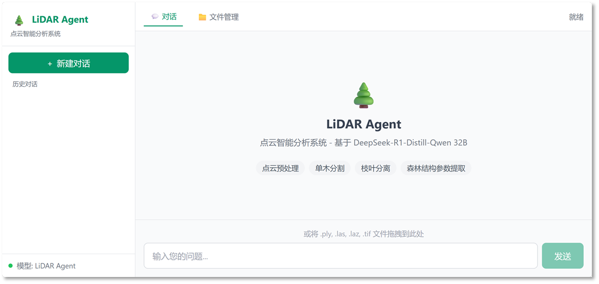

# LiDAR Agent : 面向生态遥感领域的激光雷达点云智能体。



LiDAR Agent 是一种面向生态遥感领域的点云智能体框架，旨在解决传统大语言模型在专业领域知识理解、多模态数据处理以及复杂点云分析任务中的应用局限。该智能体以领域适配后的大语言模型作为核心推理引擎，通过模型微调增强其对 LiDAR 生态遥感知识的理解能力，并结合模型上下文协议（Model Context Protocol, MCP）实现大语言模型与外部专业工具的高效连接。

在功能设计上，LiDARAgent 构建了“知识理解—任务规划—工具调用—结果反馈”的智能化处理流程，使大语言模型能够根据用户需求自主识别任务类型、选择合适的点云分析工具，并完成森林点云数据的自动化处理与分析。通过集成包括多种点云处理算法，LiDARAgent 能够支持结构参数提取、生态指标计算以及专业知识问答等多类任务，有效提升了大语言模型在 LiDAR 生态遥感场景中的适用性。

与传统基于固定流程的遥感数据处理方法相比，LiDARAgent 不仅突破了大语言模型缺乏领域知识和工具操作能力的限制，还增强了人工智能系统对复杂三维空间数据的理解与分析能力。该框架将大语言模型的自然语言交互能力与 LiDAR 专业算法能力相结合，实现了从自然语言指令到点云智能分析任务执行的自动化转换，为森林资源监测、生态参数反演以及智能化遥感分析提供了一种新的技术范式。

## 环境要求

- GPU：至少 4 张 NVIDIA RTX 3090
- Python：3.10

`start_vllm_server.sh` 默认使用 4 张 GPU，并设置如下参数：

```bash
CUDA_VISIBLE_DEVICES=0,1,2,3
TENSOR_PARALLEL_SIZE=4
```

如果实际 GPU 编号不同，可在启动前通过环境变量调整。

## 安装步骤

### 1. 进入项目目录

```bash
cd LiDARAgent
```

### 2. 下载模型文件

将模型文件保存至 `llm_model` 文件夹：

```bash
mkdir llm_model
```

### 3. 创建并激活 Python 环境

```bash
conda create -n lidaragent python=3.10 -y
conda activate lidaragent
```

### 4. 安装 Python 依赖

```bash
pip install -r requirements.txt
```

### 5. 安装项目库文件

```bash
find mcp_llm_web/backend/tools/lib -name setup.py -print -execdir python setup.py install \;
```

安装本地库前，请确保当前 Python 环境已安装编译相关依赖，并且系统具备可用的 C/C++ 编译器。

## 启动服务

### 1. 启动大语言模型服务

```bash
bash start_vllm_server.sh
```

### 2. 启动后端服务

```bash
cd mcp_llm_web/backend
python main.py
```

### 3. 启动前端服务

```bash
cd mcp_llm_web/frontend
npm run dev
```

终端会输出访问地址，通常为 `http://localhost:5173`。在浏览器中打开该地址即可进入 Web 应用界面。
